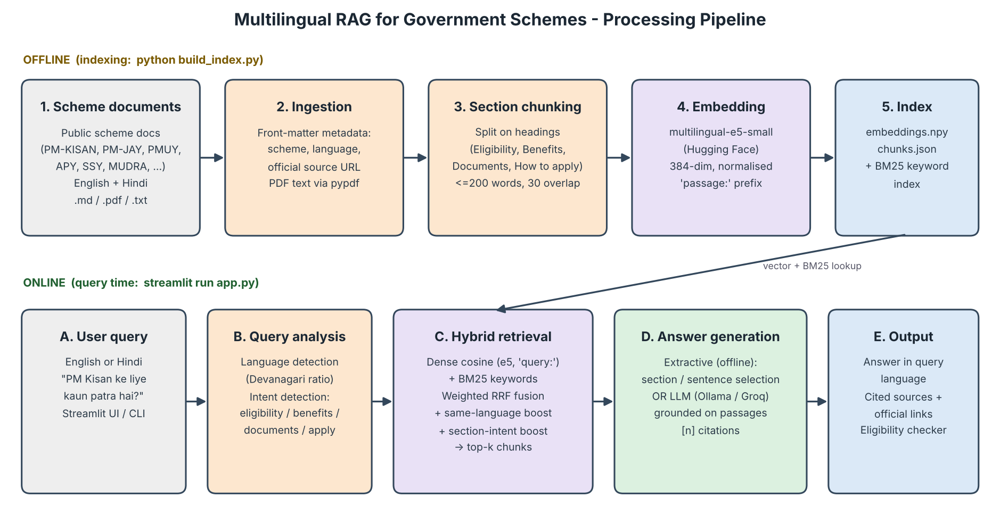

# 🏛️ Multilingual RAG for Government Schemes

A question-answering system over **publicly available Indian government scheme documents** that
accepts questions in **English and Hindi**, retrieves the relevant passages with **multilingual
embeddings**, and returns **cited eligibility information**.

> Experiential Learning Assignment — Task 11: *Multilingual RAG for Government Schemes*
> Course: Language Processing Using Machine Learning and LLMs
> Group 11 · Aakashdeep Paul · Ananwita Dash · Palak Sengar · Sneha Singh

## 🎥 Demo Video

▶️ **[Watch the demonstration video](https://drive.google.com/file/d/1mvV1kWomDNoK_1pIeqMphC709dSD5Eci/view)**

📦 **GitHub repository:** https://github.com/Ananwita/Govscheme-rag



---

## ✨ Features

| Feature | Details |
|---|---|
| Bilingual Q&A | Ask in English or Hindi (Devanagari); answer comes back in the same language |
| Multilingual embeddings | `intfloat/multilingual-e5-small` (Hugging Face) — Hindi and English share one vector space, so cross-lingual retrieval works |
| Hybrid retrieval | Dense cosine similarity + BM25 keyword search, fused with weighted Reciprocal Rank Fusion |
| Smart re-ranking | Same-language boost + section-intent boost (an "eligibility" question prefers *Eligibility / Exclusions* sections) |
| Cited answers | Every answer carries `[n]` citations to the scheme, section and official source URL |
| LLM generation | OpenAI `gpt-oss-120b` via Groq (free API key) writes the cited answer from the retrieved passages; Gemini / Ollama also supported; offline extractive answerer as fallback |
| Eligibility checker | Fill a profile → see likely/maybe/not-eligible schemes with the cited eligibility text |
| Add your own docs | Upload official PDFs in the app → index is rebuilt automatically |
| Evaluation | 44 labelled EN + HI questions → Hit@1, Hit@3, MRR, Section@1, FactRecall, ablation + cross-lingual test |

### Schemes covered (each in English + Hindi = 20 documents)
PM-KISAN · Ayushman Bharat PM-JAY · PM Ujjwala Yojana · Sukanya Samriddhi Yojana · Atal Pension Yojana ·
PMJJBY & PMSBY · PM MUDRA Yojana · MGNREGA · PM Vishwakarma · PMAY-Gramin

---

## 📁 Project structure

```
govscheme-rag/
├── app.py                 # Streamlit web app (main demo)
├── cli.py                 # Terminal Q&A
├── build_index.py         # Step 1: build the vector index
├── evaluate.py            # Evaluation + chart
├── make_samples.py        # Generates sample inputs/outputs for the report
├── make_diagram.py        # Draws docs/pipeline_diagram.png
├── requirements.txt
├── .env.example           # Settings template (embedding model, LLM) - copy to .env
├── src/
│   ├── config.py          # All settings
│   ├── ingest.py          # Load .md/.pdf/.txt + section-aware chunking
│   ├── text_utils.py      # Language detection, tokeniser, intent detection
│   ├── embeddings.py      # Multilingual sentence-transformer (+ TF-IDF fallback)
│   ├── bm25.py            # BM25 keyword retrieval
│   ├── index.py           # Build / load index
│   ├── retriever.py       # Hybrid retrieval + RRF + boosts
│   ├── generator.py       # Extractive & LLM answer generation with citations
│   ├── eligibility.py     # Rule-based eligibility screener
│   └── pipeline.py        # End-to-end RAG pipeline
├── data/schemes/
│   ├── en/*.md            # English scheme documents
│   └── hi/*.md            # Hindi scheme documents
├── eval/questions.json    # 22 English + 22 Hindi labelled questions
├── samples/sample_queries.txt
├── docs/
│   ├── pipeline_diagram.png   # Processing pipeline block diagram
│   └── CONTRIBUTIONS.md       # Group details and contributions
├── index/                 # generated: embeddings.npy, chunks.json, meta.json
└── .vscode/               # launch configs (one-click run), tasks, settings
```

---

## 🚀 Setup in VS Code (Windows / macOS / Linux)

**Requirements:** Python 3.10 – 3.12 recommended, ~1.5 GB free disk (PyTorch + model), internet for the first run.

1. Download the project and open the folder in VS Code (**File → Open Folder…**). Install the recommended *Python* extension when prompted.
   ```bash
   git clone https://github.com/Ananwita/Govscheme-rag.git
   cd Govscheme-rag
   ```
   (or **Code → Download ZIP** on GitHub and unzip it)
2. Open a terminal (**Terminal → New Terminal**) and create a virtual environment:

   **Windows (PowerShell)**
   ```powershell
   python -m venv .venv
   .\.venv\Scripts\Activate.ps1
   pip install -r requirements.txt
   ```
   If PowerShell blocks activation, run once: `Set-ExecutionPolicy -Scope CurrentUser RemoteSigned`

   **macOS / Linux**
   ```bash
   python3 -m venv .venv
   source .venv/bin/activate
   pip install -r requirements.txt
   ```
   *(Faster, smaller CPU-only PyTorch: `pip install torch --index-url https://download.pytorch.org/whl/cpu` before the line above.)*

3. Select the interpreter: `Ctrl+Shift+P` → **Python: Select Interpreter** → choose `.venv`.

4. Build the index (first run downloads the ~470 MB embedding model from Hugging Face):
   ```bash
   python build_index.py
   ```
5. Launch the web app:
   ```bash
   streamlit run app.py
   ```
   It opens at **http://localhost:8501**.

**One-click alternative:** open the *Run and Debug* panel (`Ctrl+Shift+D`) and pick
`1. Build index`, `2. Run Streamlit app`, `3. CLI`, `4. Evaluate` or `5. Generate sample outputs`.

### Other commands
```bash
python cli.py                                  # interactive terminal Q&A
python cli.py "अटल पेंशन योजना में शामिल होने की उम्र क्या है?"
python evaluate.py                             # metrics -> eval/results.md + eval/metrics_chart.png
python make_samples.py                         # answers -> samples/sample_outputs.md
```

---

## 🤖 LLM generation step (OpenAI gpt-oss-120b via Groq)

In RAG, the last step is an LLM that writes the answer from the retrieved passages. The LLM gets
ONLY the top-k passages and is instructed to answer from them alone, in the user's language, with
`[n]` citations. If no LLM is connected (or it is unreachable), an offline extractive answerer is used.

This project uses OpenAI's open-weight model **`openai/gpt-oss-120b`**, served free through the **Groq API**.

**Option A — from the app (easiest):**
1. Get a free API key from **Groq**: https://console.groq.com/keys
2. In the app sidebar open **🤖 LLM (generation step) → Connect an LLM**, choose **Groq**, paste the key,
   set **Model** to `openai/gpt-oss-120b`, and click **Connect**.
3. Keep *Remember on this computer* ticked; the settings are saved to `.env`.

**Option B — with a `.env` file:** copy `.env.example` to `.env` in the project folder and fill in your key:
```
LLM_BASE_URL=https://api.groq.com/openai/v1
LLM_MODEL=openai/gpt-oss-120b
LLM_API_KEY=your_groq_api_key_here
```
Then restart the app. The LLM connects automatically every time.

> 🔒 `.env` is listed in `.gitignore`, so your API key is never uploaded. Never put a real key in code or in `.env.example`.

**Other providers:** Google Gemini (free key from https://aistudio.google.com/apikey) or Ollama running
locally (`ollama pull qwen2.5:3b`). See `.env.example`. If the chosen model is not offered by the
provider, the app automatically picks a similar available one.

---

## 🧠 Models and tools

| Component | Model / library | Link |
|---|---|---|
| Multilingual embeddings | `intfloat/multilingual-e5-small` (118M params, 384-dim) | https://huggingface.co/intfloat/multilingual-e5-small |
| Alternative embeddings | `paraphrase-multilingual-MiniLM-L12-v2`, `BAAI/bge-m3` | https://huggingface.co/sentence-transformers/paraphrase-multilingual-MiniLM-L12-v2 · https://huggingface.co/BAAI/bge-m3 |
| Keyword retrieval | Okapi BM25 (own NumPy implementation) | — |
| Generation LLM | **OpenAI gpt-oss-120b via Groq** (used) · alternatives: gpt-oss-20b, Llama-3.3-70B (Groq), Gemini 2.5 Flash, Qwen2.5-3B (Ollama) | https://console.groq.com · https://aistudio.google.com · https://ollama.com/library/qwen2.5 |
| Framework | sentence-transformers, PyTorch, NumPy, scikit-learn, pypdf, Streamlit, requests, Matplotlib | — |

Change the embedding model with `EMBEDDING_MODEL=` in `.env`, then rerun `python build_index.py`.

---

## 📊 Evaluation

`python evaluate.py` runs 44 labelled questions (22 English, 22 Hindi) and compares:

* **hybrid** – the full system
* **dense_only** / **bm25_only** – ablation of each retriever
* **cross_lingual** – Hindi questions searched only in English documents and vice-versa; this
  measures what the multilingual embeddings contribute

Metrics: Hit@1, Hit@3, MRR (correct scheme retrieved), Section@1 (top passage is from the section
the question asks about), FactRecall (expected fact such as "Rs 6,000" appears in the answer).
Results are written to `eval/results.md`, `eval/results.json` and `eval/metrics_chart.png`, and shown
in the app's *How it works* tab.

---

## ➕ Adding more schemes

* Drop official PDFs into `data/schemes/` (or upload them in the app sidebar), then rebuild the index.
* For best citations, add Markdown files with front matter:
  ```markdown
  ---
  scheme_id: pm_svanidhi
  title: PM SVANidhi
  language: en
  ministry: Ministry of Housing and Urban Affairs
  source: https://pmsvanidhi.mohua.gov.in/
  ---
  ## Eligibility
  ...
  ```
  Use the same `scheme_id` for the Hindi version with `language: hi`.

---

## ⚠️ Limitations

* The corpus is a curated summary of 10 central schemes from official portals; benefit amounts and
  rules change, so answers always carry a "verify on the official portal" note.
* LLM generation needs internet access and an API key; without it, the extractive fallback returns whole
  sections rather than a personalised yes/no answer. Cited source passages are always shown beside the answer.
* The eligibility checker uses simplified rules and is a screening aid, not an official decision.
* Hindi in Roman script ("Hinglish") is handled only partially (BM25 on English tokens + embeddings).
* Scanned (image-only) PDFs need OCR before indexing.

## 🔭 Future scope
More Indian languages (Odia, Bengali, Tamil — the e5 model already supports them), State schemes,
voice input with Whisper, OCR for scanned PDFs, a cross-encoder re-ranker, and deployment on
Hugging Face Spaces.

---

## 👥 Team and contributions (Group 11)

| Name | Roll No. | Contribution |
|---|---|---|
| Aakashdeep Paul | 2330055 | Data collection: English and Hindi scheme documents, metadata and source verification; labelled evaluation questions |
| Ananwita Dash | 2330067 | Ingestion and section-aware chunking, multilingual embeddings, BM25 and hybrid retriever |
| Palak Sengar | 2330097 | Cited answer generation (extractive and LLM), language and intent detection, eligibility checker |
| Sneha Singh | 2330120 | Streamlit web application, evaluation script, project report, slides and demonstration video |

Details: [docs/CONTRIBUTIONS.md](docs/CONTRIBUTIONS.md)

## 📚 References
1. Wang et al., *Multilingual E5 Text Embeddings: A Technical Report*, 2024. https://arxiv.org/abs/2402.05672
2. Lewis et al., *Retrieval-Augmented Generation for Knowledge-Intensive NLP Tasks*, NeurIPS 2020.
3. Robertson & Zaragoza, *The Probabilistic Relevance Framework: BM25 and Beyond*, 2009.
4. Cormack et al., *Reciprocal Rank Fusion outperforms Condorcet and individual rank learning methods*, SIGIR 2009.
5. OpenAI, *gpt-oss-120b* open-weight model, served via Groq: https://console.groq.com/docs/models
6. Official scheme portals: pmkisan.gov.in · nha.gov.in/PM-JAY · pmuy.gov.in · indiapost.gov.in · npscra.nsdl.co.in ·
   jansuraksha.gov.in · mudra.org.in · nrega.nic.in · pmvishwakarma.gov.in · pmayg.nic.in · myscheme.gov.in

**GitHub repository:** https://github.com/Ananwita/Govscheme-rag

**Demo video:** https://drive.google.com/file/d/1mvV1kWomDNoK_1pIeqMphC709dSD5Eci/view
